# Changelog

## 2017 - Static beginnings

In June 2017 a friend showed me his website. It made me want a place of my own on the web, so I started by recreating the idea and then quickly moved toward something that felt more personal.

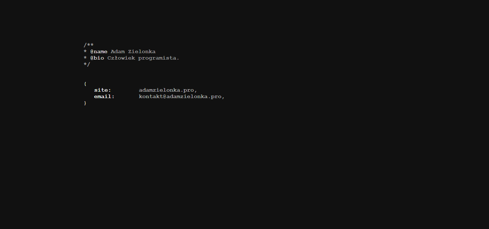

The next step was the first terminal-inspired version. It was still simple, but the direction of the project was already clear.

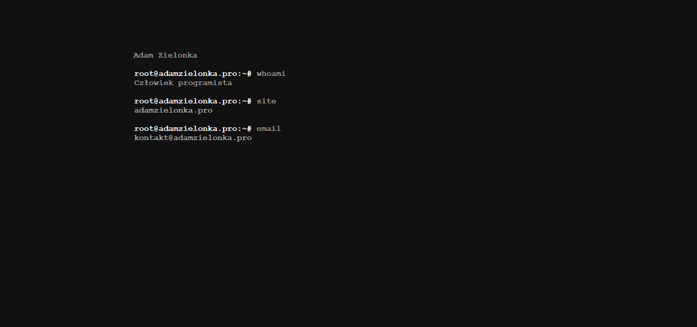
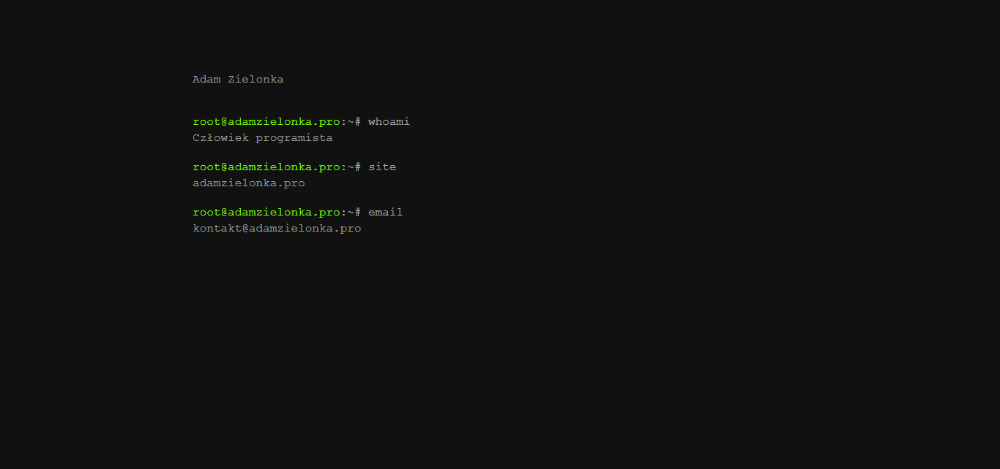
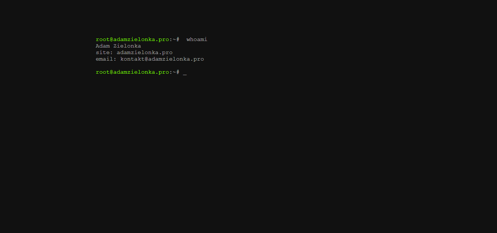
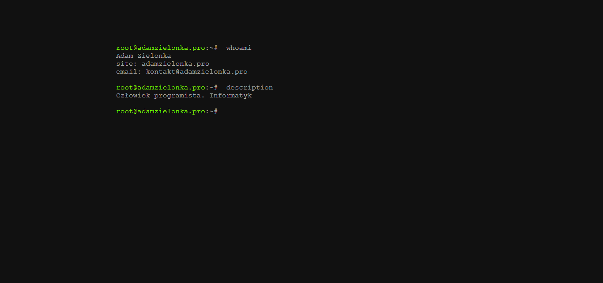
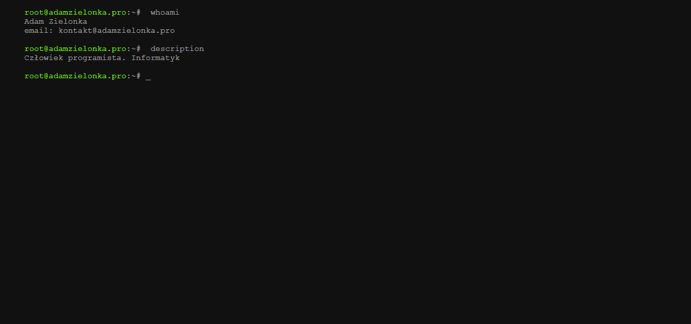

By October 2017 I finally had projects worth linking to, so the website started to feel like a portfolio instead of an empty shell.

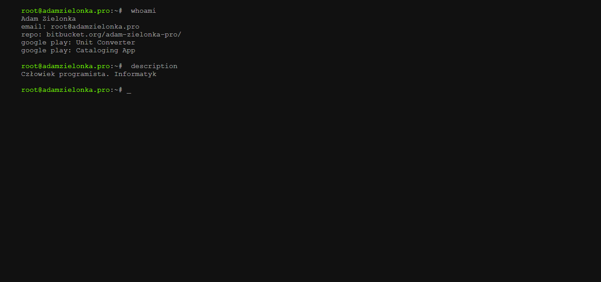

## 2018 - A clearer `whoami`

At the start of 2018 I reworked the `whoami` layout so the site could present more structured information: contact details, repositories, apps, and games.

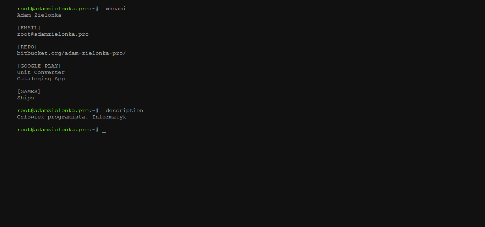
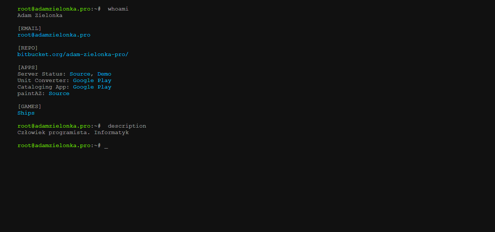
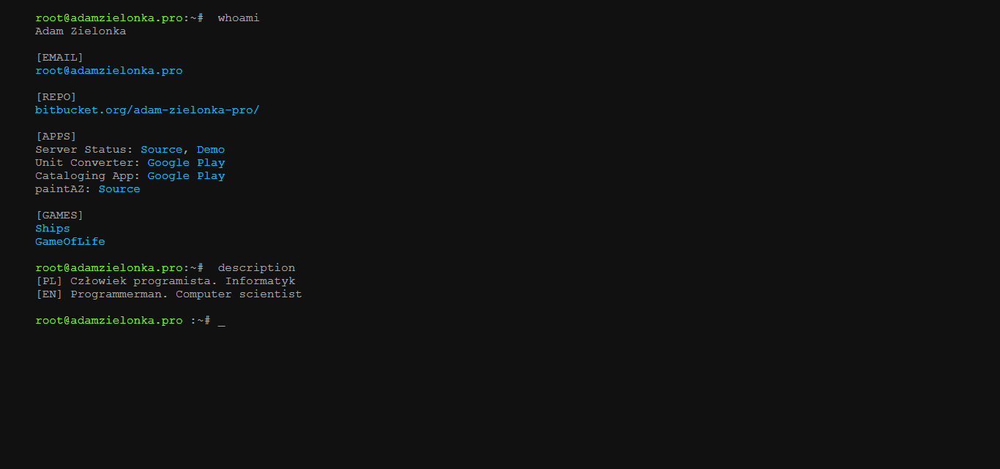

By autumn 2018 the static version had reached its final major polish pass.

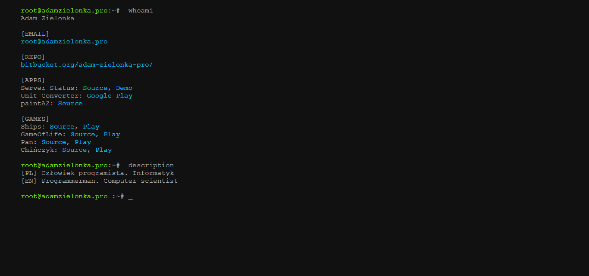

## 2019 - React and interaction

In March 2019 I moved the website to React. The static version stayed available as the `noscript` fallback, but the first React version still looked very close to the old site.

In August 2019 I rewrote the terminal code to support richer interaction and aligned the animation with the non-JavaScript version so both experiences felt consistent.

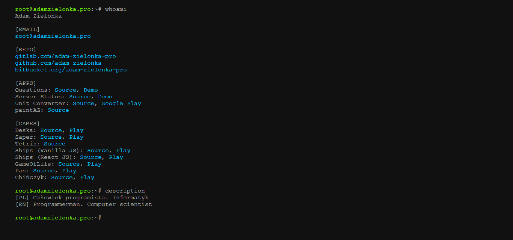

## 2021 - Svelte rewrite

In December 2021 a friend convinced me to try Svelte, and the site was rewritten again. Keeping markup, styles, and logic together felt great, and the rewrite took only a few days once the structure clicked.

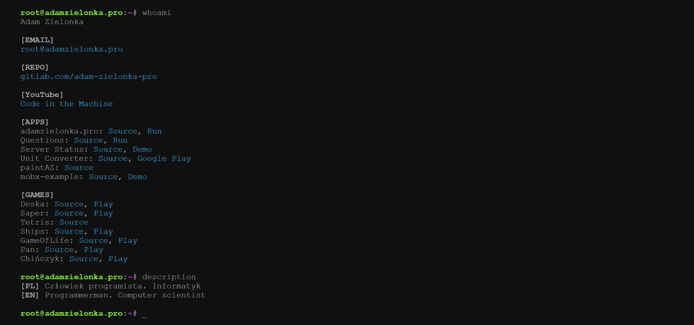

## 2023 - Back to React

On 5 February 2023 I moved the project back to React. I did not look at the old React code; I just rewrote the Svelte components again, this time with the benefit of everything I had learned in the meantime.

## 2024 - Goodbye React, goodbye MobX

On 5 May 2024 I rewrote the components with `createElement` and removed framework/runtime dependencies from the built version of the app.

## 2024 - Goodbye custom domain

At the end of May 2024 I decided to retire the custom domain. GitHub Pages is enough for this project and a better fit for a portfolio that doubles as a playground for experiments.

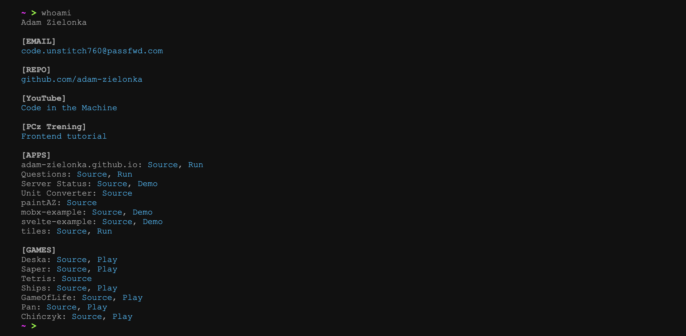

## 2026 - A portfolio you can click or type through

The terminal stays, with a clearer introduction, three selected projects and a
catalog with individual descriptions and direct links. Navigation works with
clicks, touch or commands, including a real virtual `projects` directory.

The input now uses a native text field. Keyboard navigation, copying selected
text, reduced motion, animation cancellation and escaped command output are
covered by regression tests. Project descriptions remain available when scripts
cannot run. Typography is self-hosted, and the layout adapts to smaller screens.

English is the main language throughout the interface, project descriptions,
terminal help, status messages, accessibility labels and page metadata.

The `neo` / `matrix` sequence and `exit` / `shutdown` now cover the browser
viewport. The shutdown screen restores the classic orange Windows 95 message on
black. Matrix preserves the portfolio behind it and supports Escape, Ctrl+C and
a static view when animations are disabled.

The terminal now supports `cat` for the home files and each project README,
including relative, home and absolute paths, multiple files and Tab completion.
Directory listings use the same file catalog and let visitors open files by
clicking their names.

Every project now has an ASCII illustration based on its purpose. Project lists
show compact drawings, while project details and README views show a larger
version. The drawings include accessible descriptions and remain available
without JavaScript.

The catalog now includes DOS Pascal Docker and the Analytic Hierarchy Process
desktop app, with their own ASCII illustrations. Every project has a fuller
English description and technology stack, including Pan's search strategies and
Chińczyk's opponents and mobile controls. Projects with published releases link
to their latest download page in both interactive and static views.

### 27 October 2026 - The terminal comes first

The page now opens directly with the terminal. The introduction and “Curiosity,
written in code.” headline appear at the start of `whoami`, before the selected
projects. The duplicate top navigation, site footer and text below the terminal
have been removed; the `try` shortcuts provide the main navigation.

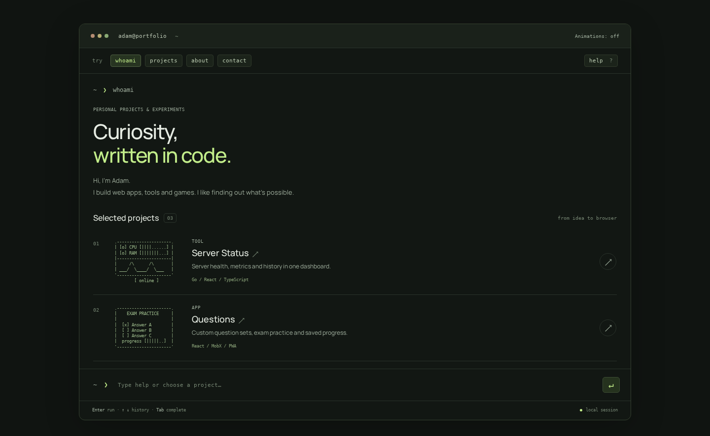

### 31 October 2026 - More room on desktop

Large desktop windows now use a fluid terminal frame up to 1600 px wide, with
output filling the available viewport height and scrolling inside the terminal.
The command shortcuts, input and bottom hints stay available. From 1440 px, the
existing home introduction sits beside the selected projects, so all three are
visible immediately on a large screen. Long descriptions retain their readable
width. The layout also applies to the static fallback, while phones and short
windows keep their previous layout.

### 6 November 2026 - A CRT on the desk

The terminal now lives inside a CRT monitor, with textured beige plastic, curved
glass, scanlines and a green, single-column interior. A worn, round power button
sits beside separate power and disk LEDs. The disk light flickers during commands
and occasionally while idle; reduced motion keeps it steady during commands.

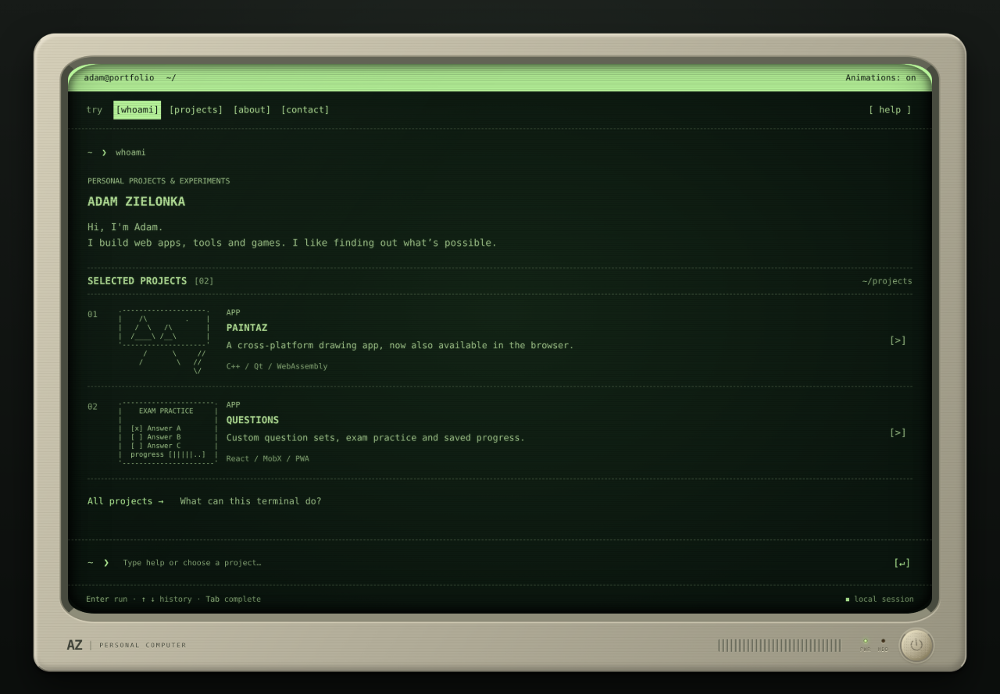

Each visit to `whoami` draws a random selection from the complete project catalog.
The number of projects fits the available screen height and adjusts on resize
without reshuffling. Small screens keep at least one project, with the rest of its
content available by scrolling. The `projects` command still shows everything,
and running commands scroll their output to the latest text.

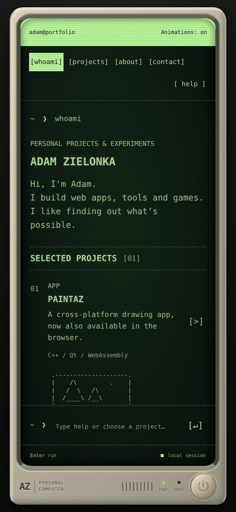

Matrix and the Windows 95-style shutdown message now fill the CRT screen while
its case remains visible. Matrix has no overlay button; Escape or Ctrl+C returns
to the terminal. The case power button can stop a command, turn the monitor off
and start a fresh session, replacing the old restart control on the shutdown
screen.

Powering back on with the case button opens a Linux-style boot sequence immediately,
without first typing a command into the shell. Fictional portfolio services start
one by one across the whole CRT screen before the portfolio or a linked page
appears. Ordinary visits and refreshes skip this automatic sequence; `boot` can
also replay it from the terminal.

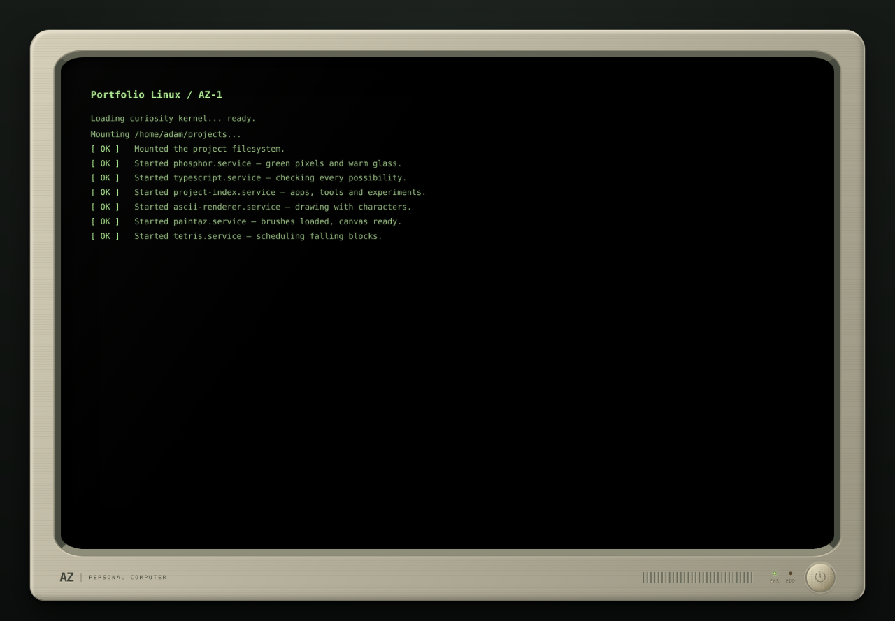
