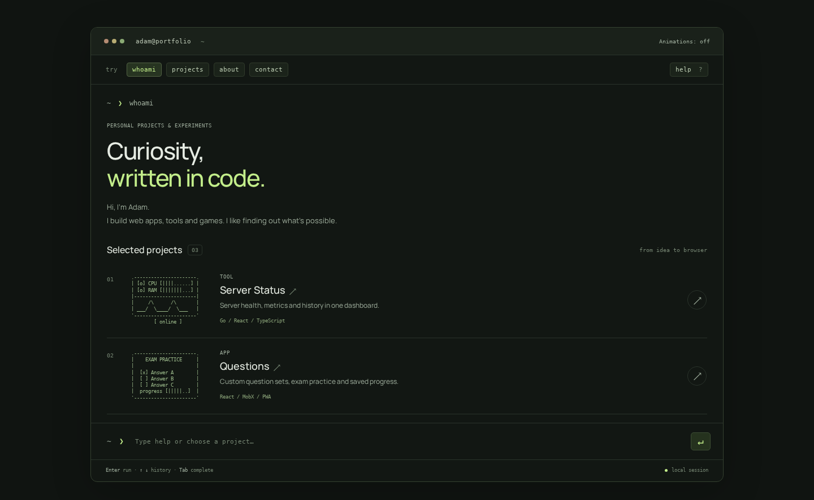

# adam-zielonka.github.io

Adam Zielonka's interactive portfolio, published at [adam-zielonka.github.io](https://adam-zielonka.github.io/).

A terminal-inspired interface with selected projects, project descriptions, a browsable catalog and clickable commands. Built with TypeScript, native DOM APIs and SCSS. Project descriptions and links also work without JavaScript. The public interface and project descriptions are written in English.



## Explore

Click a project or navigation shortcut, or enter a command:

| Command | Result |
| --- | --- |
| `whoami` / `home` | Selected projects |
| `projects` | Full project catalog |
| `project server-status` | Project description, demo and source |
| `about` | About the author and the portfolio |
| `contact` | GitHub profile and project repositories |
| `ls` | Current directory contents |
| `cat about.md` | Read a file from the home directory |
| `cat projects/server-status/README.md` | Read a project description by path |
| `cd projects` | Open the project directory |
| `cd server-status` | Open a project directory from `~/projects` |
| `pwd` | Current path |
| `help` | All available commands |
| `clear` | Clear output |
| `neo` / `matrix` | Matrix sequence filling the CRT screen |
| `exit` / `shutdown` | Classic Windows 95 shutdown screen |

Use Enter to execute, ↑/↓ for history, and Tab to complete commands, project names and paths. Directory suggestions for `cd` end with `/`, so you can keep typing a nested path without an extra space. Shift+Tab leaves the input; Tab also leaves it when the prompt is empty. Ctrl+C interrupts a running command without interfering with copying selected text.

The home directory contains `README.md`, `about.md`, `contact.md` and `projects/`.
Every project directory has its own `README.md`. `cat` accepts relative paths,
`~/` and `/root/` paths, and several files at once, such as
`cat about.md contact.md`. Tab completes file paths, and clicking a filename in
`ls` reads it. File contents are displayed using the portfolio's existing layout.

Animation preferences can be changed in the terminal toolbar. Reduced-motion preferences are respected by default, and an ongoing animation can be skipped.

Commands started by a click or a shared link are typed into the terminal before
their results appear. Manually entered commands are printed immediately.
Results appear progressively as complete paragraphs, directory entries and
project cards, keeping links and ASCII illustrations intact. Skip reveals the
rest immediately; Ctrl+C stops the command and restores the prompt.

The old `ls` Easter egg now appears when `cd` points to a missing directory:
“There is nothing. Only warm, primordial blackness.” The directory stays unchanged.
Other classic extras remain: `ping` / `pong`, `neo YourName`, `cls`, `description`
and the hidden `panic` command (reload to recover from its simulated kernel panic).
`font` changes the terminal text, prompt and completion font; using it without an
argument restores the default. Project typography and ASCII art keep their fonts.

`neo` and `matrix` fill the CRT screen while its case and glass effects remain
visible, without clearing the portfolio behind them. The covered terminal controls
are inactive until the scene closes. Escape, Ctrl+C or the back button in the
scene returns to the terminal; the animated sequence also returns automatically
when it finishes.
With animations disabled, all messages remain visible until dismissed.

`exit` and `shutdown` show “Wait ...” in the terminal for a second, then display
the orange “It's now safe to turn off your computer”
message on black inside the same CRT screen, a nod to the Windows 95 shutdown
screen for computers that needed to be powered off manually. Use Restart
terminal or Escape to reload.

Project links use fragments such as [`/#project/server-status`](https://adam-zielonka.github.io/#project/server-status), so direct links and browser Back/Forward work on GitHub Pages.

On desktop windows at least 1280 px wide and 700 px tall, the terminal grows to
1600 px wide and fits the viewport height, with scrollable output and the prompt
always available. From 1440 px, the home introduction sits beside the three
selected projects. Longer descriptions keep their readable column width; phones
and short windows retain their compact layout. The same home layout is available
without JavaScript.

## Development

See [DEVELOPMENT.md](DEVELOPMENT.md) for runtime requirements.

```sh
pnpm install --frozen-lockfile
pnpm dev
pnpm test
pnpm lint
pnpm fmt:check
pnpm build
pnpm preview
```

## Content and commands

[src/projects/](src/projects/) is the single source of project content for the
interactive interface, virtual project `README.md` files and static HTML fallback.
Each project has one `<id>.md` file with YAML front matter: `id` (matching the
filename), `name`, `category`, `summary`, `stack`, `source` and a unique positive
`order` controlling catalog order. Optional fields are `demo`, `releases` and
`featured`; set `featured: true` on the three projects displayed on the home screen.

Write the description as Markdown below the front matter, using `### The idea`
and `### How it works` headings. Paragraphs, lists, links and emphasis are rendered
as normal Markdown, independently of the line-by-line terminal command format.
The shared parser validates metadata, attaches the existing ASCII art by project
ID and renders the body with `marked`. Vite supplies the same source files to the
browser that Node reads for the fallback; editing, adding or deleting a project
Markdown file reloads the development page. No generated content files or extra
build commands are needed.

The catalog contains 19 projects, including Soma, DOS Pascal Docker and the
Analytic Hierarchy Process desktop app. Each entry includes its purpose, implementation
and technology stack. Use the optional `releases` field for projects with
published downloads; `releases/latest` keeps the link pointed at the latest
stable GitHub release. Release links appear in project details, virtual README
files and the static HTML fallback.

Each project has an original ASCII illustration in
[src/data/project-art.ts](src/data/project-art.ts). The same drawing appears as a
thumbnail in project lists and at a larger size in project details, including
`cat README.md` and the static HTML fallback. Keep drawings in plain ASCII;
`description` provides the accessible image label.

Commands are Markdown files in [src/commands](src/commands/) with YAML front matter:

- `command` — command name
- `alias` — optional aliases
- `help` — description shown by `help`

The body is rendered line by line. Regular Markdown links stay clickable. Special action links control the terminal:

- `sleep:` pauses before the next line, for example `[](sleep:500)`
- `system:` runs built-in actions such as `clear`, `shutdown`, `help`, `font`, `cd`, `ls`, `cat`, `home`, `projects`, `project`, `about` and `contact`
- `const:` inserts escaped runtime text: `command`, `args` or `pwd`
- `ui:` supports `animate` and `hide`
- `css:` applies styles, for example `[#6CA391](css:color)`

Author-written Markdown may contain HTML. User-entered values are treated as text, including when inserted into command output.

## License

Code: MIT. The bundled Manrope font uses the [SIL Open Font License](public/fonts/OFL-Manrope.txt) and is served locally.
