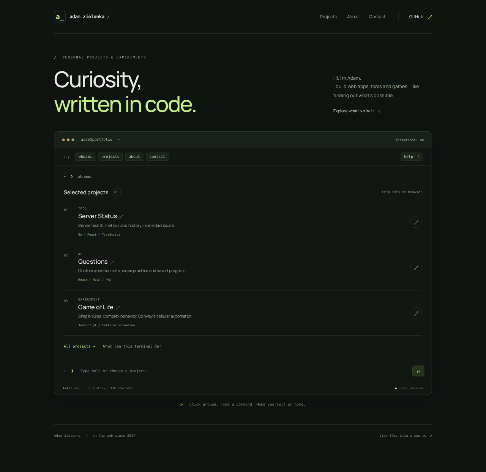

# adam-zielonka.github.io

Adam Zielonka's interactive portfolio, published at [adam-zielonka.github.io](https://adam-zielonka.github.io/).

A terminal-inspired interface with selected projects, project descriptions, a browsable catalog and clickable commands. Built with TypeScript, native DOM APIs and SCSS. Project descriptions and links also work without JavaScript. The public interface and project descriptions are written in English.



## Explore

Click a project or navigation shortcut, or enter a command:

| Command | Result |
| --- | --- |
| `whoami` / `home` | Selected projects |
| `projects` | Full project catalog |
| `project server-status` | Project description, demo and source |
| `about` | About the author and the portfolio |
| `contact` | GitHub profile and project repositories |
| `ls` | Current directory contents |
| `cd projects` | Open the project directory |
| `cd server-status` | Open a project directory from `~/projects` |
| `pwd` | Current path |
| `help` | All available commands |
| `clear` | Clear output |

Use Enter to execute, ↑/↓ for history, and Tab to complete a command or project name. Shift+Tab leaves the input; Tab also leaves it when the prompt is empty. Ctrl+C interrupts a running command without interfering with copying selected text.

Animation preferences can be changed in the terminal toolbar. Reduced-motion preferences are respected by default, and an ongoing animation can be skipped.

Project links use fragments such as [`/#project/server-status`](https://adam-zielonka.github.io/#project/server-status), so direct links and browser Back/Forward work on GitHub Pages.

## Development

See [DEVELOPMENT.md](DEVELOPMENT.md) for runtime requirements.

```sh
pnpm install --frozen-lockfile
pnpm dev
pnpm test
pnpm lint
pnpm fmt:check
pnpm build
pnpm preview
```

## Content and commands

[src/data/projects.ts](src/data/projects.ts) is the shared project catalog for the interactive interface and the static HTML fallback. Set `featured: true` on the three projects displayed on the home screen. Longer project descriptions use the optional `idea` and `decisions` fields.

Commands are Markdown files in [src/commands](src/commands/) with YAML front matter:

- `command` — command name
- `alias` — optional aliases
- `help` — description shown by `help`

The body is rendered line by line. Regular Markdown links stay clickable. Special action links control the terminal:

- `sleep:` pauses before the next line, for example `[](sleep:500)`
- `system:` runs built-in actions such as `clear`, `shutdown`, `help`, `font`, `cd`, `ls`, `home`, `projects`, `project`, `about` and `contact`
- `const:` inserts escaped runtime text: `command`, `args` or `pwd`
- `ui:` supports `animate` and `hide`
- `css:` applies styles, for example `[#6CA391](css:color)`

Author-written Markdown may contain HTML. User-entered values are treated as text, including when inserted into command output.

## License

Code: MIT. The bundled Manrope font uses the [SIL Open Font License](public/fonts/OFL-Manrope.txt) and is served locally.
