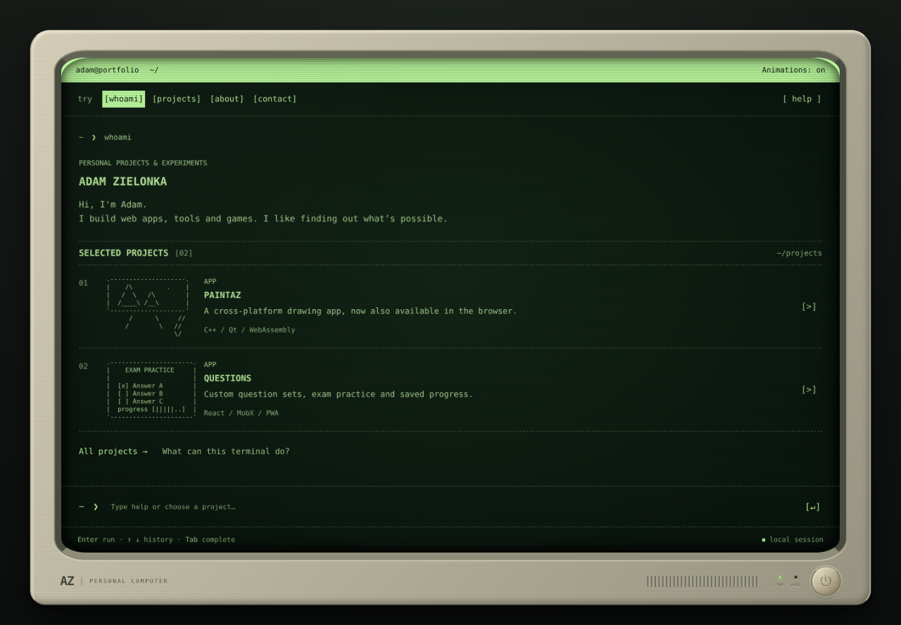

# adam-zielonka.github.io

Adam Zielonka's interactive portfolio, published at [adam-zielonka.github.io](https://adam-zielonka.github.io/).

A terminal-inspired interface with selected projects, project descriptions, a browsable catalog and clickable commands. Built with TypeScript, native DOM APIs and SCSS. Project descriptions and links also work without JavaScript. The public interface and project descriptions are written in English.



## Explore

Click a project or navigation shortcut, or enter a command:

| Command | Result |
| --- | --- |
| `whoami` / `home` | Selected projects |
| `projects` | Full project catalog |
| `project server-status` | Project description, demo and source |
| `about` | About the author and the portfolio |
| `contact` | GitHub profile and project repositories |
| `ls` | Current directory contents |
| `cat about.md` | Read a file from the home directory |
| `cat projects/server-status/README.md` | Read a project description by path |
| `cd projects` | Open the project directory |
| `cd server-status` | Open a project directory from `~/projects` |
| `pwd` | Current path |
| `help` | All available commands |
| `clear` | Clear output |
| `windows` / `win` | Portfolio 98, an interactive Windows 98-style portfolio desktop |
| `neo` / `matrix` | Matrix sequence filling the CRT screen |
| `exit` / `shutdown` | Shut down (text-only in the terminal; after MS-DOS mode, `exit` returns to Portfolio 98) |
| `boot` | Linux-style startup with fictional portfolio services |

Use Enter to execute, ↑/↓ for history, and Tab to complete commands, project names and paths. Directory suggestions for `cd` end with `/`, so you can keep typing a nested path without an extra space. Shift+Tab leaves the input; Tab also leaves it when the prompt is empty. Ctrl+C interrupts a running command without interfering with copying selected text.

Output scrolls to the latest text as a command runs, including Matrix inside the
CRT. Each `whoami` / `home` draws a new random selection from the entire project
catalog. The number of complete entries fits the available terminal height,
reserving room for the introduction and actions. Very short screens keep at least
one entry. Resizing adjusts the count without reshuffling; `projects` always
shows the complete catalog.

The home directory contains `README.md`, `about.md`, `contact.md` and `projects/`.
Every project directory has its own `README.md`. `cat` accepts relative paths,
`~/` and `/root/` paths, and several files at once, such as
`cat about.md contact.md`. Tab completes file paths, and clicking a filename in
`ls` reads it. File contents are displayed using the portfolio's existing layout.

Animation preferences can be changed in the terminal toolbar or, in Portfolio 98,
under Start ▸ Settings ▸ Animations. Reduced-motion preferences are respected by default; explicitly choosing “Animations: on” overrides that default for both CSS motion and timed sequences. An ongoing animation can be skipped.

Commands started by a click or a shared link are typed into the terminal before
their results appear. Manually entered commands are printed immediately.
Results appear progressively as complete paragraphs, directory entries and
project cards, keeping links and ASCII illustrations intact. Skip reveals the
rest immediately; Ctrl+C stops the command and restores the prompt.

The old `ls` Easter egg now appears when `cd` points to a missing directory:
“There is nothing. Only warm, primordial blackness.” The directory stays unchanged.
Other classic extras remain: `ping` / `pong`, `neo YourName`, `cls`, `description`
and the hidden `panic` command (power-cycle the monitor to recover from its simulated kernel panic).
`font` changes the terminal text, prompt and completion font; using it without an
argument restores the default. Project typography and ASCII art keep their fonts.

`windows` (alias `win`, or the shareable `#windows` URL) opens
[Portfolio 98](#portfolio-98), a Windows 98-style portfolio desktop inside the
same CRT.

`neo` and `matrix` fill the CRT screen while its case and glass effects remain
visible, without clearing the portfolio behind them. The covered terminal controls
are inactive until the scene closes. Escape or Ctrl+C returns to the terminal;
the animated sequence also returns automatically
when it finishes.
With animations disabled, all messages remain visible until dismissed.

`exit` and `shutdown` in the terminal show “Wait ...”, then the orange safe-to-turn-off
message, without the graphical animation. After Portfolio 98's MS-DOS mode or
MS-DOS Prompt, `exit` and `win` return to Portfolio 98 instead, until you
navigate elsewhere or switch the computer off.

Use the physical power button on the CRT case to turn the screen off, then press
it again to start a fresh terminal session. The same button can stop a running
command or Matrix. The power LED goes dark when off; Escape does not restart shutdown.
The round, worn power button has separate green power and amber disk LEDs.
The decorative disk indicator flickers more often during commands and occasionally
while idle, and stops at shutdown or power-off. With animations disabled or reduced
motion enabled, it stays steady during commands and dark while idle.

Turning the computer back on with the case button in Windows mode (`#windows`)
opens the Portfolio 98 startup screen directly, then restores the desktop. In
terminal mode it runs `boot` before opening the portfolio (or the linked page). Power-on opens the boot screen immediately,
without typing `boot` at a shell prompt. The boot log fills the CRT screen, covering
the terminal controls until startup finishes. It starts fictional services for the project
catalog, ASCII art, paintAZ, Tetris, Game of Life and more, with paced `[ OK ]`
messages and disk activity. Ordinary visits and refreshes skip this sequence;
the power-on marker is consumed once without changing the URL. You can also type
`boot` to replay it. Escape skips the remaining animation, and reduced motion
prints the log without delays; Ctrl+C
stops startup, and the power button can switch off during it.

Project links use fragments such as [`/#project/server-status`](https://adam-zielonka.github.io/#project/server-status), so direct links and browser Back/Forward work on GitHub Pages.

At every screen size, the monitor fits the viewport height, with scrollable
output and the prompt always available. On desktop windows at least 1280 px wide
and 700 px tall, the terminal grows to 1600 px wide. Inside the CRT, a single-column
text layout, bracketed commands and monochrome typography echo a classic terminal.
Longer descriptions keep their readable column width; phones and short windows
retain their compact layout.
The same home layout is available without JavaScript.

The CRT is drawn with CSS and an SVG displacement filter. The picture bows by an
amount that scales with the screen, 0.8% of the opposite side: up to 8 px in the
terminal's text mode and up to 3.5 px in graphics mode (the Portfolio 98 desktop
and its startup and shutdown screens), as monitors kept geometry for each video
mode. The raster is underscanned: it sits a few pixels inside dark, unlit glass,
and its rounded corners (tighter in graphics mode) bend with the picture, so the
bezel never hides the Start button, the clock or a maximized window's Close
button. The filter averages four sub-pixel samples (two at a device pixel ratio
of 2 or more), offset for the device pixel ratio, so the middle of the screen
stays sharp at any zoom, and the scanlines snap to device pixels. Small controls
near the edges — the terminal shortcuts and toolbar, Start, Quick Launch, taskbar
buttons, the clock and title-bar buttons — respond where they are drawn, not
where the flat layout puts them. A one-pixel dither would beat into moiré
under the filter, so while the effects are on the Shut Down dither is drawn as
an even 50% dim, and the checkerboards of scrollbar tracks and the active
taskbar button as their average gray. Black screens (the boot log, the Matrix
and “It's now safe to turn off your computer”) are drawn in the color of the
unlit tube, never darker than the glass around them. The first paint already
bends the picture for the screen's size, and a visitor who turned the effects
off sees a flat picture from the start.

WebKit never bends the picture. This covers Safari on macOS, iPhone and iPad,
every other browser on iPhone and iPad, and the WebKitGTK and WPE browsers.
WebKit applies an SVG filter only to the parts it draws on the filtered layer.
It leaves out the content of scrolling boxes, which it scrolls on separate
layers, and anything stacked over them. That content stays flat and can come
loose from its window. In WebKitGTK the scrolled content stayed flat inside a
bent frame, and a Safari report showed long Help articles and narrow Explorer
windows spilling past the window frame. A short user-agent check (`isWebKit` in
`src/utils/crt-curvature.ts`, repeated in `index.html` for the first paint)
keeps the picture flat in WebKit. It also keeps clicks where the controls are
and keeps the one-pixel checkerboards. The scanlines, edge falloff and glass
remain, so Display effects turns only those on and off.

Turn the effects off in Portfolio 98 with Start ▸ Settings ▸ Display effects or
in Display Properties (the desktop's Properties). The choice is remembered in
this browser and leaves a flat picture in the same case. The effects also switch
off automatically with `prefers-contrast: more` or forced colors; the setting
then shows as off and unavailable, and the stored choice is kept. Firefox at
fractional display scaling may soften the picture; turning Display effects off
keeps it crisp. The displacement map is an inline image; regenerate it with
`node scripts/crt-map.mjs --write`.

## Portfolio 98

Commands, the navigation shortcut and direct links all show a Windows 98-style
startup splash before the desktop: an original terminal-and-project-folders
emblem above the Portfolio 98 wordmark, clouds, and a thin animated strip at the
bottom, without extra status text. Escape skips it; Ctrl+C cancels startup.
Disabled animations open the desktop immediately. This is a portfolio
simulation, not an operating system emulator, and all of its artwork is
original.

The desktop's original pixel icons — My Computer, My Projects, Recycle Bin,
Games, paintAZ, About Adam.txt, Contact and MS-DOS Prompt — fill each column from
top to bottom, then continue in the next column; they scroll only when the
desktop space is exhausted. My Projects opens to the right of them. Icons follow
the Classic selection model: a click selects an icon, and a double-click or Enter
opens it; on a touch screen, a tap opens it. A double-click counts only when both
clicks press the same icon, so a click on a menu item or button that disappears
never opens what was under it. Selecting a desktop icon gives the desktop the
foreground. The desktop and every folder or result list are single Tab stops;
the arrow keys, Home, End, Page Up, Page Down and typing the first letters of a
name move the selection.

Start opens a cascading menu with a vertical Portfolio 98 banner:

- **Programs** ▸ Games, Applications, Tools and Experiments & Learning, each with
  Open folder and its projects, then My Projects and MS-DOS Prompt
- **Documents** ▸ About Adam.txt and up to ten projects opened in this session
- **Settings** ▸ Animations and Display effects
- **Find** ▸ Projects… (F3) and People… (the Address Book)
- **Help**, a guide to Portfolio 98
- **Run…**, which opens a project, folder or program by name, such as `tetris`,
  `games`, `notepad` or `command`
- **Shut Down…**

Submenus open on hover, on click or with the arrow keys, and underlined letters
choose items. The taskbar holds Start, a Quick Launch bar (Show Desktop, My
Projects and Find), a button for every window and a clock whose tooltip shows
the date (screen readers read the full date with it). Show Desktop minimizes
every window; pressing it again restores them in the same order, unless another
window was opened or activated in between. Quick Launch and the window buttons
are each one Tab stop: the arrow keys move between their buttons, and Tab leaves
from there. Right-click Start for Open (My Projects), Explore and Find….

Explorer browses the Portfolio (C:) drive with File, View, Go and Help menus,
Back, Forward and Up buttons, an Address list of every place, and four views:
Large Icons, Small Icons, List and Details. Click a Details column heading to
sort, and click it again to reverse the order. As in Windows 98, a selected item
highlights its name only, and the toolbar's gray glyphs take their colors under
the mouse. The panel on the left describes
the selected project, with its technologies and links to its demo and source
code, and the status bar counts the objects. My Computer and Recycle Bin are
Explorer places too.

Find: Projects searches by name (Named), by text in summaries, technologies and
descriptions (Containing text), and in the whole drive or one folder (Look in,
with Include subfolders). Results appear in a sortable Details list, and the
dialog has Find Now, Stop and New Search buttons. About Adam.txt opens in Notepad as
read-only plain text, with Word Wrap, Select All, Copy, and Search ▸ Find… (F3
finds the next match). Project windows have File, View and Help menus: open the
demo in a new tab, view the source code or releases, maximize, read the
project's help topics or its About box. Web demos run inside their window.
External links open in a new tab.

Drag a title bar to move a window, and drag its border, a corner or the size
grip to resize it; double-click the title bar to maximize. The icon at the left
of a title bar opens the window's system menu (Restore, Minimize, Maximize and
Close), and double-clicking it closes the window. Switching windows — by a
taskbar button, a title bar or restoring a minimized window — returns the
keyboard to the control that last had it in that window, such as Find's Named
field or Explorer's file list. Clicking a caption or toolbar button leaves the
keyboard where it was, as in Windows 98. Right-click anything, press Shift+F10
or the Menu key, or touch and hold for a shortcut menu:

- an icon: Open, Explore (folders, My Computer and Recycle Bin), Open in New Tab
  and Source Code (projects), and Properties;
- the desktop: Arrange Icons, Refresh and Properties, which opens Display
  Properties with Animations and Display effects;
- the taskbar: Cascade Windows, Tile Windows Horizontally or Vertically, and
  Minimize All Windows;
- a taskbar button or title bar: the window's system menu, including Close.

Message boxes and dialogs are modal: while one is open, a press elsewhere on the
desktop does nothing and keeps the keyboard in the box, and no shortcut menu or
desktop shortcut acts behind it. Dialogs and property sheets (Run, Properties,
Display Properties) right-align their buttons; property sheets show their tab.

With a mouse or another fine pointer and more than 540 px of room, Portfolio 98
uses the exact Windows 98 metrics: 11 px text, 18 px title bars, a 28 px
taskbar, 75 × 23 px buttons, a 75 px icon grid and three-dimensional scrollbars
(silver colors in Firefox), plus pale yellow tooltips after half a second of
hovering. Touch screens keep larger targets, resize windows with a larger size
grip only and never show tooltips; their Start and shortcut menus open submenus
in place, with a Back row. At 540 px or less (phones), windows fill the screen
and cannot be moved or resized, Quick Launch keeps only Show Desktop, Explorer
hides its side panel and shows the selected item's summary in the status bar,
and Find's buttons move below its fields. Short touch screens (phones in
landscape) keep the desktop layout but fold the chrome: no side panel, icon-only
tool buttons beside the Address field and slimmer rows, so a row of icons stays
visible; Find scrolls inside its window there. With forced colors (such as Windows
High Contrast), window frames, buttons, the active title bar and the active
taskbar button keep system-color borders and highlights.

Start ▸ Shut Down… dims the whole screen with a classic dither and asks what the
computer should do. The dialog remembers the last choice, and Help explains the
options:

- **Stand by** blanks the screen and turns the CRT's power LED amber; any key or
  click wakes it.
- **Shut down** keeps the desktop dimmed, shows the startup artwork with only
  “Portfolio 98 is shutting down.” at the bottom (no loading strip), then the
  orange “It's now safe to turn off your computer” message on black inside the
  same CRT screen. Escape or Ctrl+C skips the animation; disabled animations go
  straight to the final message.
- **Restart** shows the shutdown and startup screens, then a fresh desktop,
  without reloading the page. Disabled animations open the fresh desktop at once.
  Escape on the startup screen skips to the new desktop; Ctrl+C cancels it and
  leaves the terminal, as an interrupted `windows` does.
- **Restart in MS-DOS mode** returns to the terminal, which ends with “Type EXIT
  to return to Portfolio 98.” `exit` or `win` then starts Portfolio 98 again with
  its startup screen.

MS-DOS Prompt, on the desktop or in Start ▸ Programs, also returns to the
terminal, and `exit` there comes straight back without the startup screen.
Navigating to another page or switching the computer off forgets the way back,
and `exit` shuts down again. The physical power button also works on the desktop.

### Keyboard

| Keys | In Portfolio 98 |
| --- | --- |
| Tab / Shift+Tab | Move between the desktop, menu bars, toolbars, lists and the taskbar |
| Arrow keys, Home, End, Page Up, Page Down | Move in icon lists, menus and the taskbar |
| Letters | Select the icon whose name starts with them |
| Enter / Space | Open / select the focused icon |
| Esc | Close the open menu, one level at a time, or the dialog |
| Ctrl+Esc | Open Start¹ |
| F10 | Move to the window's menu bar, at its first menu |
| Alt+Shift+letter | Open a menu-bar menu by its underlined letter, also from another open menu² |
| Shift+F10 / Menu key | Open the focused item's shortcut menu |
| Alt+Space | Open the window's system menu¹ |
| Alt+F4 | Close the window or dialog you are using; on the desktop or taskbar, Shut Down…¹ |
| F3 | Find projects; in Notepad, find the next match |
| Backspace | Go up one folder in Explorer |
| Alt+← / Alt+→ | Go back or forward in Explorer |
| Alt+↓ / F4 | Open Explorer's Address list |
| Ctrl+Alt | Release a running game's keyboard; click the game, or press Enter on its window, to give it back³ |

¹ Windows, macOS or the browser may keep these keys for themselves. Start, the
taskbar and every window control also work without them.<br>
² Browsers use Alt+letter for their own menus (Chrome takes Alt+F and Alt+E), so
Alt+Shift+letter is the browser-safe accelerator. Plain letters work once a menu
bar has focus.<br>
³ In production the demos share the portfolio's origin. On other hosts, such as
the development server, demos are cross-origin: Ctrl+Alt and Ctrl+Esc inside a
game work only if the demo opts in by posting a message to Portfolio 98.

## Development

See [DEVELOPMENT.md](DEVELOPMENT.md) for runtime requirements.

```sh
pnpm install --frozen-lockfile
pnpm dev
pnpm test
pnpm lint
pnpm fmt:check
pnpm build
pnpm preview
```

## Content and commands

[src/projects/](src/projects/) is the single source of project content for the
interactive interface, virtual project `README.md` files and static HTML fallback.
Each project has one `<id>.md` file with YAML front matter: `id` (matching the
filename), `name`, `category`, `summary`, `stack`, `source` and a unique positive
`order` controlling catalog order. Optional fields are `demo`, `releases` and
`featured`; set `featured: true` for entries in the deterministic no-JavaScript
home fallback. The interactive home samples from all projects.

Write the description as Markdown below the front matter, using `### The idea`
and `### How it works` headings. Paragraphs, lists, links and emphasis are rendered
as normal Markdown, independently of the line-by-line terminal command format.
The shared parser validates metadata, attaches the existing ASCII art by project
ID and renders the body with `marked`. Vite supplies the same source files to the
browser that Node reads for the fallback; editing, adding or deleting a project
Markdown file reloads the development page. No generated content files or extra
build commands are needed.

The catalog contains 20 projects, including Soma, DOS Pascal Docker and the
Analytic Hierarchy Process desktop app. Each entry includes its purpose, implementation
and technology stack. Use the optional `releases` field for projects with
published downloads; `releases/latest` keeps the link pointed at the latest
stable GitHub release. Release links appear in project details, virtual README
files and the static HTML fallback.

Each project has an original ASCII illustration in
[src/data/project-art.ts](src/data/project-art.ts). The same drawing appears as a
thumbnail in project lists and at a larger size in project details, including
`cat README.md` and the static HTML fallback. Keep drawings in plain ASCII;
`description` provides the accessible image label.

Commands are Markdown files in [src/commands](src/commands/) with YAML front matter:

- `command` — command name
- `alias` — optional aliases
- `help` — description shown by `help`

The body is rendered line by line. Regular Markdown links stay clickable. Special action links control the terminal:

- `sleep:` pauses before the next line, for example `[](sleep:500)`
- `system:` runs built-in actions such as `clear`, `shutdown`, `help`, `font`, `cd`, `ls`, `cat`, `home`, `projects`, `project`, `about` and `contact`
- `const:` inserts escaped runtime text: `command`, `args` or `pwd`
- `ui:` supports `animate` and `hide`
- `css:` applies styles, for example `[#6CA391](css:color)`

Author-written Markdown may contain HTML. User-entered values are treated as text, including when inserted into command output.

## License

Code: MIT. The bundled Manrope font uses the [SIL Open Font License](public/fonts/OFL-Manrope.txt) and is served locally.
