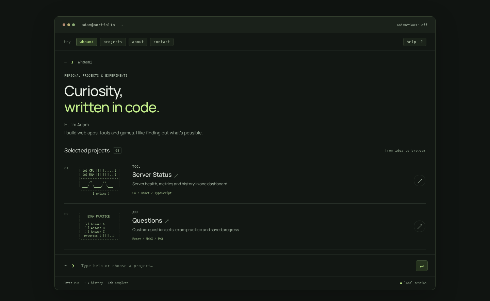

# adam-zielonka.github.io

Adam Zielonka's interactive portfolio, published at [adam-zielonka.github.io](https://adam-zielonka.github.io/).

A terminal-inspired interface with selected projects, project descriptions, a browsable catalog and clickable commands. Built with TypeScript, native DOM APIs and SCSS. Project descriptions and links also work without JavaScript. The public interface and project descriptions are written in English.



## Explore

Click a project or navigation shortcut, or enter a command:

| Command | Result |
| --- | --- |
| `whoami` / `home` | Selected projects |
| `projects` | Full project catalog |
| `project server-status` | Project description, demo and source |
| `about` | About the author and the portfolio |
| `contact` | GitHub profile and project repositories |
| `ls` | Current directory contents |
| `cat about.md` | Read a file from the home directory |
| `cat projects/server-status/README.md` | Read a project description by path |
| `cd projects` | Open the project directory |
| `cd server-status` | Open a project directory from `~/projects` |
| `pwd` | Current path |
| `help` | All available commands |
| `clear` | Clear output |
| `neo` / `matrix` | Full-screen Matrix sequence |
| `exit` / `shutdown` | Classic Windows 95 shutdown screen |

Use Enter to execute, ↑/↓ for history, and Tab to complete commands, project names and paths. Directory suggestions for `cd` end with `/`, so you can keep typing a nested path without an extra space. Shift+Tab leaves the input; Tab also leaves it when the prompt is empty. Ctrl+C interrupts a running command without interfering with copying selected text.

The home directory contains `README.md`, `about.md`, `contact.md` and `projects/`.
Every project directory has its own `README.md`. `cat` accepts relative paths,
`~/` and `/root/` paths, and several files at once, such as
`cat about.md contact.md`. Tab completes file paths, and clicking a filename in
`ls` reads it. File contents are displayed using the portfolio's existing layout.

Animation preferences can be changed in the terminal toolbar. Reduced-motion preferences are respected by default, and an ongoing animation can be skipped.

`neo` and `matrix` take over the browser viewport without clearing the portfolio
behind them. Escape, Ctrl+C or the back button in the scene returns to the
terminal; the animated sequence also returns automatically when it finishes.
With animations disabled, all messages remain visible until dismissed.

`exit` and `shutdown` display the orange “It's now safe to turn off your computer”
message on black, a nod to the Windows 95 shutdown screen for computers that
needed to be powered off manually. Use Restart terminal or Escape to reload.

Project links use fragments such as [`/#project/server-status`](https://adam-zielonka.github.io/#project/server-status), so direct links and browser Back/Forward work on GitHub Pages.

## Development

See [DEVELOPMENT.md](DEVELOPMENT.md) for runtime requirements.

```sh
pnpm install --frozen-lockfile
pnpm dev
pnpm test
pnpm lint
pnpm fmt:check
pnpm build
pnpm preview
```

## Content and commands

[src/data/projects.ts](src/data/projects.ts) is the shared project catalog for the interactive interface and the static HTML fallback. Set `featured: true` on the three projects displayed on the home screen. Longer project descriptions use the optional `idea` and `decisions` fields.

The catalog contains 19 projects, including Soma, DOS Pascal Docker and the
Analytic Hierarchy Process desktop app. Each entry includes its purpose, implementation
and technology stack. Use the optional `releases` field for projects with
published downloads; `releases/latest` keeps the link pointed at the latest
stable GitHub release. Release links appear in project details, virtual README
files and the static HTML fallback.

Each project has an original ASCII illustration in
[src/data/project-art.ts](src/data/project-art.ts). The same drawing appears as a
thumbnail in project lists and at a larger size in project details, including
`cat README.md` and the static HTML fallback. Keep drawings in plain ASCII;
`description` provides the accessible image label.

Commands are Markdown files in [src/commands](src/commands/) with YAML front matter:

- `command` — command name
- `alias` — optional aliases
- `help` — description shown by `help`

The body is rendered line by line. Regular Markdown links stay clickable. Special action links control the terminal:

- `sleep:` pauses before the next line, for example `[](sleep:500)`
- `system:` runs built-in actions such as `clear`, `shutdown`, `help`, `font`, `cd`, `ls`, `cat`, `home`, `projects`, `project`, `about` and `contact`
- `const:` inserts escaped runtime text: `command`, `args` or `pwd`
- `ui:` supports `animate` and `hide`
- `css:` applies styles, for example `[#6CA391](css:color)`

Author-written Markdown may contain HTML. User-entered values are treated as text, including when inserted into command output.

## License

Code: MIT. The bundled Manrope font uses the [SIL Open Font License](public/fonts/OFL-Manrope.txt) and is served locally.
