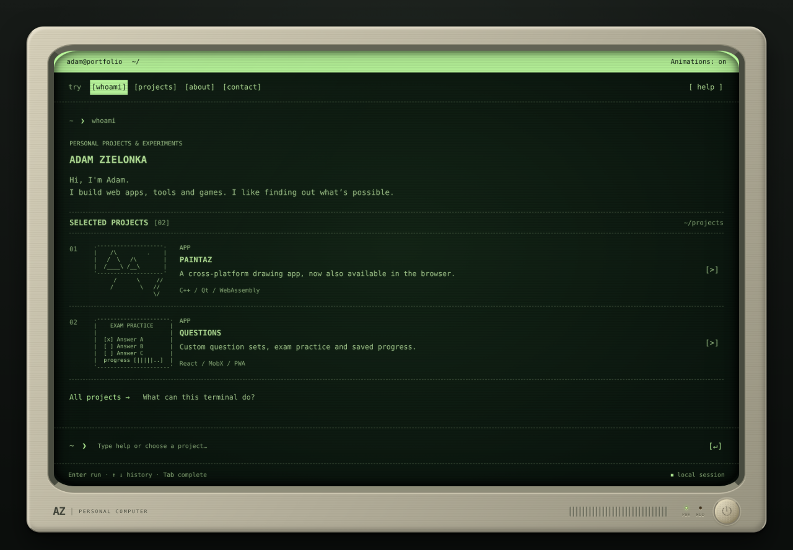

# adam-zielonka.github.io

Adam Zielonka's interactive portfolio, published at [adam-zielonka.github.io](https://adam-zielonka.github.io/).

A terminal-inspired interface with selected projects, project descriptions, a browsable catalog and clickable commands. Built with TypeScript, native DOM APIs and SCSS. Project descriptions and links also work without JavaScript. The public interface and project descriptions are written in English.



## Explore

Click a project or navigation shortcut, or enter a command:

| Command | Result |
| --- | --- |
| `whoami` / `home` | Selected projects |
| `projects` | Full project catalog |
| `project server-status` | Project description, demo and source |
| `about` | About the author and the portfolio |
| `contact` | GitHub profile and project repositories |
| `ls` | Current directory contents |
| `cat about.md` | Read a file from the home directory |
| `cat projects/server-status/README.md` | Read a project description by path |
| `cd projects` | Open the project directory |
| `cd server-status` | Open a project directory from `~/projects` |
| `pwd` | Current path |
| `help` | All available commands |
| `clear` | Clear output |
| `windows` / `win` | Interactive Windows 98-style portfolio desktop |
| `neo` / `matrix` | Matrix sequence filling the CRT screen |
| `exit` / `shutdown` | Animated Windows 98-style shutdown |
| `boot` | Linux-style startup with fictional portfolio services |

Use Enter to execute, ↑/↓ for history, and Tab to complete commands, project names and paths. Directory suggestions for `cd` end with `/`, so you can keep typing a nested path without an extra space. Shift+Tab leaves the input; Tab also leaves it when the prompt is empty. Ctrl+C interrupts a running command without interfering with copying selected text.

Output scrolls to the latest text as a command runs, including Matrix inside the
CRT. Each `whoami` / `home` draws a new random selection from the entire project
catalog. The number of complete entries fits the available terminal height,
reserving room for the introduction and actions. Very short screens keep at least
one entry. Resizing adjusts the count without reshuffling; `projects` always
shows the complete catalog.

The home directory contains `README.md`, `about.md`, `contact.md` and `projects/`.
Every project directory has its own `README.md`. `cat` accepts relative paths,
`~/` and `/root/` paths, and several files at once, such as
`cat about.md contact.md`. Tab completes file paths, and clicking a filename in
`ls` reads it. File contents are displayed using the portfolio's existing layout.

Animation preferences can be changed in the terminal toolbar. Reduced-motion preferences are respected by default; explicitly choosing “Animations: on” overrides that default for both CSS motion and timed sequences. An ongoing animation can be skipped.

Commands started by a click or a shared link are typed into the terminal before
their results appear. Manually entered commands are printed immediately.
Results appear progressively as complete paragraphs, directory entries and
project cards, keeping links and ASCII illustrations intact. Skip reveals the
rest immediately; Ctrl+C stops the command and restores the prompt.

The old `ls` Easter egg now appears when `cd` points to a missing directory:
“There is nothing. Only warm, primordial blackness.” The directory stays unchanged.
Other classic extras remain: `ping` / `pong`, `neo YourName`, `cls`, `description`
and the hidden `panic` command (power-cycle the monitor to recover from its simulated kernel panic).
`font` changes the terminal text, prompt and completion font; using it without an
argument restores the default. Project typography and ASCII art keep their fonts.

`windows` (alias `win`, or the shareable `#windows` URL) opens a Windows 98-style
portfolio inside the same CRT. Commands, the navigation shortcut and direct links
all show a Windows 98-style startup splash before the desktop: an original
terminal-and-project-folders emblem above the Portfolio98 wordmark, clouds, and a thin animated strip at the
bottom, without extra status text. Escape skips it;
Ctrl+C cancels startup. Disabled animations open the desktop immediately.
Desktop icons fill each column from top to bottom, then continue in the next
column; they scroll only when the available desktop space is exhausted.
The desktop includes original pixel SVG icons,
a Start menu, taskbar with a live clock, and an Explorer containing all projects
from the existing Markdown catalog. Browse Games, Applications, Tools, or
Experiments & Learning; switch between icons and a list; open descriptions,
demos and repositories. External links open in a new tab.

Click, tap, or keyboard-activate an icon to open it. Drag title bars to move
windows, double-click a title bar to maximize, and use the window buttons or
taskbar to minimize, restore and close them. On small screens windows fit the
available display. Start → Restart in MS-DOS mode (or the MS-DOS Prompt desktop
shortcut) returns to the terminal. Start → Shut Down… runs the graphical shutdown
sequence and ends on the same safe-to-turn-off screen as the terminal command. The physical power
button also works here.
This is a portfolio simulation, not an operating system emulator.

`neo` and `matrix` fill the CRT screen while its case and glass effects remain
visible, without clearing the portfolio behind them. The covered terminal controls
are inactive until the scene closes. Escape or Ctrl+C returns to the terminal;
the animated sequence also returns automatically
when it finishes.
With animations disabled, all messages remain visible until dismissed.

`exit` and `shutdown` in the terminal show “Wait ...”, then the orange safe-to-turn-off
message, without the graphical animation.

Start → Shut Down… on the desktop dims the current screen with a
classic dither, shows the same artwork with only “Portfolio98 is shutting down.”
at the bottom (no loading strip), then displays the orange “It's now safe to turn off your computer”
message on black inside the same CRT screen. The desktop stays visible under
the first stage, without flashing back to the terminal. Escape or Ctrl+C skips
the animation; disabled animations go straight to the final message.
Use the physical
power button on the CRT case to turn the screen off, then press it again to
start a fresh terminal session. The same button can stop a running command or
Matrix. The power LED goes dark when off; Escape does not restart shutdown.
The round, worn power button has separate green power and amber disk LEDs.
The decorative disk indicator flickers more often during commands and occasionally
while idle, and stops at shutdown or power-off. With animations disabled or reduced
motion enabled, it stays steady during commands and dark while idle.

Turning the computer back on with the case button in Windows mode (`#windows`)
opens the Windows 98 startup screen directly, then restores the desktop. In
terminal mode it runs `boot` before opening the portfolio (or the linked page). Power-on opens the boot screen immediately,
without typing `boot` at a shell prompt. The boot log fills the CRT screen, covering
the terminal controls until startup finishes. It starts fictional services for the project
catalog, ASCII art, paintAZ, Tetris, Game of Life and more, with paced `[ OK ]`
messages and disk activity. Ordinary visits and refreshes skip this sequence;
the power-on marker is consumed once without changing the URL. You can also type
`boot` to replay it. Escape skips the remaining animation, and reduced motion
prints the log without delays; Ctrl+C
stops startup, and the power button can switch off during it.

Project links use fragments such as [`/#project/server-status`](https://adam-zielonka.github.io/#project/server-status), so direct links and browser Back/Forward work on GitHub Pages.

At every screen size, the monitor fits the viewport height, with scrollable
output and the prompt always available. On desktop windows at least 1280 px wide
and 700 px tall, the terminal grows to 1600 px wide. Inside the CRT, a single-column
text layout, bracketed commands and monochrome typography echo a classic terminal.
Longer descriptions keep their readable column width; phones and short windows
retain their compact layout.
The same home layout is available without JavaScript.

## Development

See [DEVELOPMENT.md](DEVELOPMENT.md) for runtime requirements.

```sh
pnpm install --frozen-lockfile
pnpm dev
pnpm test
pnpm lint
pnpm fmt:check
pnpm build
pnpm preview
```

## Content and commands

[src/projects/](src/projects/) is the single source of project content for the
interactive interface, virtual project `README.md` files and static HTML fallback.
Each project has one `<id>.md` file with YAML front matter: `id` (matching the
filename), `name`, `category`, `summary`, `stack`, `source` and a unique positive
`order` controlling catalog order. Optional fields are `demo`, `releases` and
`featured`; set `featured: true` for entries in the deterministic no-JavaScript
home fallback. The interactive home samples from all projects.

Write the description as Markdown below the front matter, using `### The idea`
and `### How it works` headings. Paragraphs, lists, links and emphasis are rendered
as normal Markdown, independently of the line-by-line terminal command format.
The shared parser validates metadata, attaches the existing ASCII art by project
ID and renders the body with `marked`. Vite supplies the same source files to the
browser that Node reads for the fallback; editing, adding or deleting a project
Markdown file reloads the development page. No generated content files or extra
build commands are needed.

The catalog contains 19 projects, including Soma, DOS Pascal Docker and the
Analytic Hierarchy Process desktop app. Each entry includes its purpose, implementation
and technology stack. Use the optional `releases` field for projects with
published downloads; `releases/latest` keeps the link pointed at the latest
stable GitHub release. Release links appear in project details, virtual README
files and the static HTML fallback.

Each project has an original ASCII illustration in
[src/data/project-art.ts](src/data/project-art.ts). The same drawing appears as a
thumbnail in project lists and at a larger size in project details, including
`cat README.md` and the static HTML fallback. Keep drawings in plain ASCII;
`description` provides the accessible image label.

Commands are Markdown files in [src/commands](src/commands/) with YAML front matter:

- `command` — command name
- `alias` — optional aliases
- `help` — description shown by `help`

The body is rendered line by line. Regular Markdown links stay clickable. Special action links control the terminal:

- `sleep:` pauses before the next line, for example `[](sleep:500)`
- `system:` runs built-in actions such as `clear`, `shutdown`, `help`, `font`, `cd`, `ls`, `cat`, `home`, `projects`, `project`, `about` and `contact`
- `const:` inserts escaped runtime text: `command`, `args` or `pwd`
- `ui:` supports `animate` and `hide`
- `css:` applies styles, for example `[#6CA391](css:color)`

Author-written Markdown may contain HTML. User-entered values are treated as text, including when inserted into command output.

## License

Code: MIT. The bundled Manrope font uses the [SIL Open Font License](public/fonts/OFL-Manrope.txt) and is served locally.
