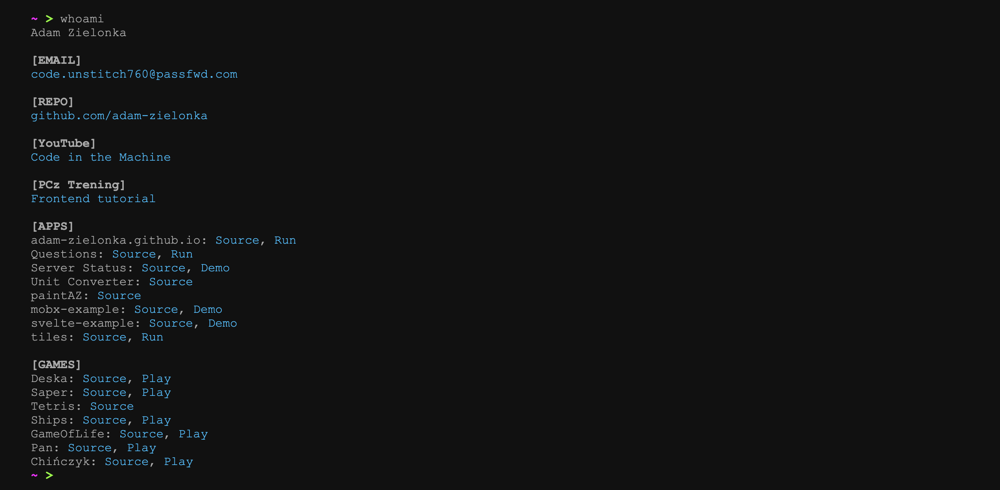

# adam-zielonka.github.io

Interactive terminal-style portfolio website published at [adam-zielonka.github.io](https://adam-zielonka.github.io/).

## How to use

1. Open [adam-zielonka.github.io](https://adam-zielonka.github.io/).
2. Wait for the startup scripts to finish.
3. Type a command.
4. Press Enter.
5. Enjoy!

## Development

Install dependencies and run the local development environment:

1. `pnpm install`
2. `pnpm dev`
3. `pnpm build`
4. `pnpm test`
5. `pnpm lint`

## Command files

Commands are stored as Markdown files in [src/commands](./src/commands/) with YAML front matter.

### Front matter

- `command` – command name
- `alias` – optional list of aliases
- `help` – description shown by the `help` command

### Body

The Markdown body is rendered line by line. Regular links remain clickable, while special action links control terminal behavior:

- `sleep:` pauses before rendering the next line, for example ``
- `system:` triggers built-in actions such as `clear`, `shutdown`, `freeze`, `help`, `font`, or `cd`
- `const:` injects runtime values such as `command`, `args`, and `pwd`
- `ui:` controls rendering with `animate` or `hide`
- `css:` applies inline styles with CSS properties such as `color`, `font-weight`, `font-size`, or `margin-top`

## License

MIT
